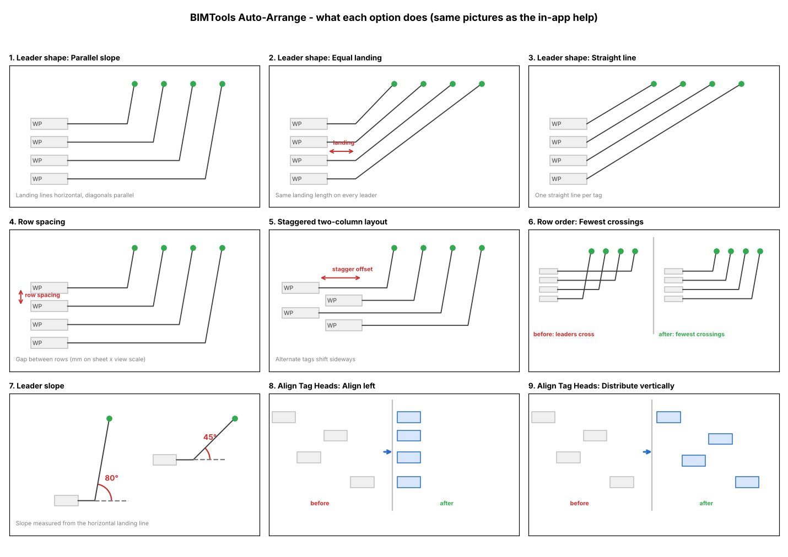
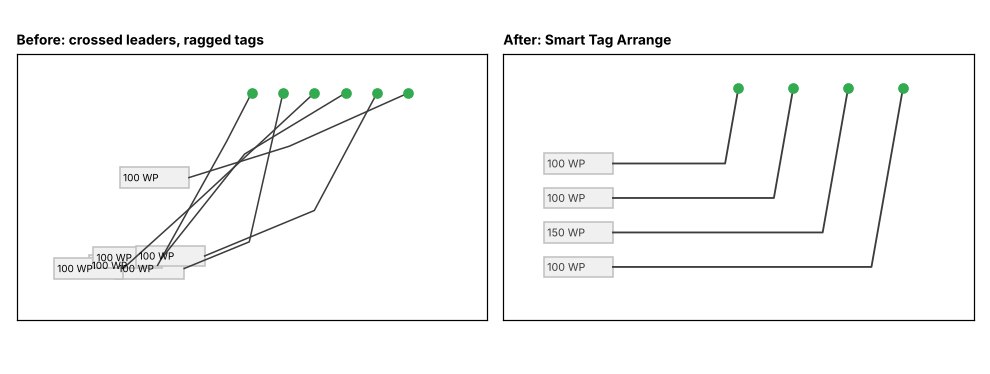

# Smart Tag Arrange 2.0 - BIMTools.TagAlign module (Revit 2020, C#)

Original implementation, written from scratch for BIMTools.TagAlign. Six commands:

| Command class | Ribbon text | Purpose |
|---|---|---|
| `AlignTagsAutoCommand` | Smart Tag Arrange | Lines tags up in tidy columns with parallel / equal-landing / straight leaders |
| `LeaderTunerCommand` | Leader Tuner | Re-shapes leaders in place (heads and leader ends stay) |
| `AlignHeadsCommand` | Align Tag Heads | Align or distribute tag heads |
| `ResolveOverlapsCommand` **(new)** | Resolve Overlaps | Nudges only the tags whose real text boxes collide |
| `FlipTagsCommand` **(new)** | Flip Tag Side | Moves tags to the other side of their elements, or a whole column across |
| `TagAuditCommand` **(new)** | Tag Audit | Finds untagged elements, duplicate tags and orphan tags; select or delete them |

## What is new in 2.0

* **Fit row spacing to the real tag size** - the tool measures every tag (height, and width for the staggered layout) and spaces rows by the tallest tag plus your padding. Two-line tags never overlap, short tags never waste space. (Measured in a SubTransaction that is always rolled back, so nothing in the model changes.)
* **Group tags into blocks** - by tag category, tag type or tag-text prefix (WP / FP / AHU ...), with a chosen empty gap between blocks. Row order and crossing minimisation run inside every group.
* **Continue an existing column** - pick a tag that is already placed; new tags stack on the same vertical line directly above it.
* **Presets** - five built-in layouts and unlimited named user presets (`%AppData%\BIMTools\AutoArrangePresets.ini`, plain text: copy the file to share an office standard).
* **Before / after report** - leader crossings, overlapping tags and total leader length on the sheet, before and after every arrange.
* **Resolve Overlaps** - smallest-move relaxation with minimum gap, maximum move limit and direction (any / vertical / horizontal). Leader ends never move; non-colliding tags are untouched. Reports how many overlaps could not be solved inside the move limit.
* **Flip Tag Side** - left/right, above/below, point mirror, or "whole column to the other side" in one click.
* **Tag Audit** - untagged elements per category, duplicate tags (same element + same tag type), orphan tags. Command links select the findings or delete duplicates/orphans in one Undo step. Works with both the old single-host and the 2022+ multi-host tag API.
* Two-tab dialog (Layout / Placement and smart options), settings now saved by reflection so future options never need extra save code. Old `AutoArrange.ini` files still load.
* Built-in help (hover picture + grey text, "?" popup) covers every new option.

## How Smart Tag Arrange works
1. Set the layout and press **Arrange**.
2. Select the tags (or preselect them).
3. **Click once** where the column starts; it grows upward using the row spacing.
   Alternatives: *Fill the space between two clicks*, *Auto column* (no clicks), or *Continue an existing column* (pick a tag).
4. Every tag gets a free-end leader (the end stays on the element), a horizontal landing line and an elbow computed from the chosen shape. The row order with the fewest leader crossings is chosen automatically.

## Dialog
**Tab "Layout"**
* **Gauge**: half-circle slope selector (0-180 degrees), quick buttons 30/45/60/75/90, numeric box.
* **Leaders**: slope, shape (Parallel slope / Equal landing / Straight line), landing length.
* **Rows**: row spacing, staggered two-column layout + offset, row order (Fewest crossings / By position / By tag text / Keep current), fill between two clicks.
* **Preset**: list, *Save as...*, *Delete*.

**Tab "Placement and smart options"**
* Auto column + side, continue an existing column, include text notes, include room/space/area tags, use all tags in the view.
* Fit row spacing to the real tag size (+ padding), group tags by (category / type / text prefix) + gap between groups, before/after numbers.

## Install
Build the `.csproj` (x64, Revit 2020 DLL paths), then copy `BIMTools.TagAlign.AutoArrange.dll` and `BIMTools.TagAlign.AutoArrange.addin` to `C:\ProgramData\Autodesk\Revit\Addins\2020\`.
On the next Revit start a **BIM TOOLS** tab appears with a **Tag Align** panel: *Smart Tag Arrange* (large), then stacked *Leader Tuner / Align Tag Heads / Resolve Overlaps*, then stacked *Flip Tag Side / Tag Audit*.
`RibbonApp.cs` (class `App`) creates the tab; if a tab called "BIM TOOLS" already exists from another add-in, the panel is added to it. Icons are generated in code (teal square with letters) - replace the `Icon(...)` calls with your own images any time.

If you instead merge these files into an existing BIMTools.TagAlign project that already builds its own ribbon, delete `RibbonApp.cs` and the `.addin` file and add the buttons yourself, using these class names (namespace `BIMTools.TagAlign.Leaders`): `AlignTagsAutoCommand`, `LeaderTunerCommand`, `AlignHeadsCommand`, `ResolveOverlapsCommand`, `FlipTagsCommand`, `TagAuditCommand`.

## Suggested workflow for a clean sheet
1. **Tag Audit** - tag whatever is missing, delete duplicates/orphans.
2. **Smart Tag Arrange** with a preset (try *Fit to tag size + groups*).
3. **Resolve Overlaps** for any leftovers, **Flip Tag Side** if a column is on the wrong side.

## Notes
* Uses the Revit 2018-2021 API (`IndependentTag.LeaderEnd`, `LeaderElbow`). Version-sensitive calls (room/space/area tags, tag host ids, `IsTaggable`) go through reflection so the code also loads on newer Revit builds; only the DLL references in the `.csproj` need to change.
* **Not compiled in Revit by the author of this package** (no Revit API available where it was written) - please report build errors. All files were checked for balanced syntax only.
* Separations are mm on the printed sheet x view scale.
* Tag size is measured from the tag's bounding box with its leader temporarily switched off (rolled back). Text notes are measured with their own box; room/space/area tags use the median size of the others.
* Text notes are moved only (leaders not re-angled). Flip Tag Side ignores text notes.
* Tag Audit checks local elements only; tags pointing into linked models are never reported as orphans.
* Not done: live dashboard, crowded-to-free-area move, tag stacker, linked-file tags.
